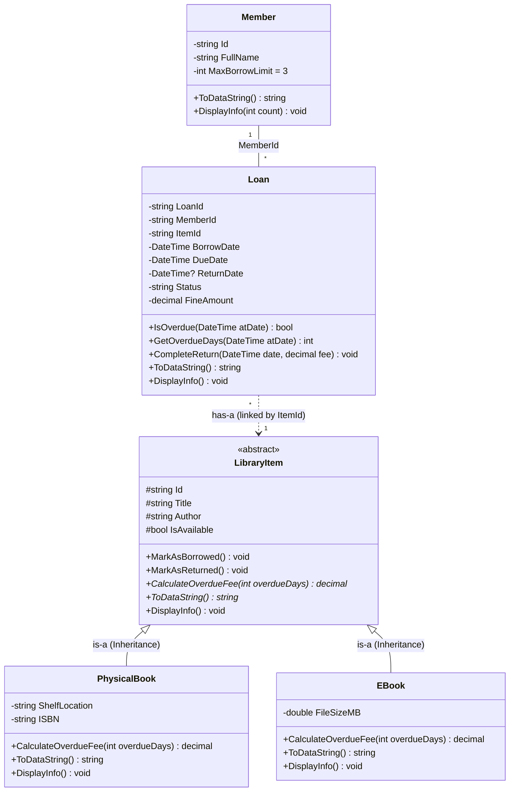

### **1. Draft UML Class Diagram**

#### **a. Sơ đồ dạng văn bản (ASCII Class Diagram)**

```text
                       +--------------------------------------------------------------+
                       |                  <<abstract>> LibraryItem                    |
                       +--------------------------------------------------------------+
                       | # Id : string                                                |
                       | # Title : string                                             |
                       | # Author : string                                            |
                       | # IsAvailable : bool                                         |
                       +--------------------------------------------------------------+
                       | + MarkAsBorrowed() : void                                    |
                       | + MarkAsReturned() : void                                    |
                       | + <<abstract>> CalculateOverdueFee(overdueDays: int): decimal|
                       | + <<abstract>> ToDataString() : string                       |
                       | + DisplayInfo() : void                                       |
                       +--------------------------------------------------------------+
                                      ^                                ^
                                      | (is-a:                         | (is-a:
            +-------------------------+  Inheritance)                  +-------------------------+
            |                                ^                                                   |
+--------------------------------------+     | (has-a: linked       +--------------------------------------+
|             PhysicalBook             |     |  by ItemId)          |                EBook                 |
+--------------------------------------+     |                      +--------------------------------------+
| - ShelfLocation : string             |     |                      | - FileSizeMB : double                |
| - ISBN : string                      |     |                      +--------------------------------------+
+--------------------------------------+     |                      | + CalculateOverdueFee(overdueDays)   |
| + CalculateOverdueFee(overdueDays)   |     |                      |   --> returns 0m                     |
|   --> returns days * 5000m           |     |                      | + ToDataString() : string            |
| + ToDataString() : string            |     |                      | + DisplayInfo() : void               |
| + DisplayInfo() : void               |     |                      +--------------------------------------+
+--------------------------------------+     |
                                             |
     +---------------------------------------+
     |
+----+----------------------------------+                   +--------------------------------------+
|                 Loan                  |                   |                Member                |
+---------------------------------------+                   +--------------------------------------+
| - LoanId : string                     |        MemberId   | - Id : string                        |
| - MemberId : string                   | * -------------- 1| - FullName : string                  |
| - ItemId : string                     |                   | - MaxBorrowLimit : int = 3           |
| - BorrowDate : DateTime               |                   +--------------------------------------+
| - DueDate : DateTime                  |                   | + ToDataString() : string            |
| - ReturnDate : DateTime?              |                   | + DisplayInfo(count: int) : void     |
| - Status : string ("Active"/"Returned")                   +--------------------------------------+
| - FineAmount : decimal                |
+---------------------------------------+
| + IsOverdue(atDate: DateTime) : bool  |
| + GetOverdueDays(atDate: DateTime):int|
| + CompleteReturn(date, fee) : void    |
| + ToDataString() : string             |
| + DisplayInfo() : void                |
+---------------------------------------+

Chú thích ký hiệu quan hệ:
  ───▷  Kế thừa (Inheritance / is-a)
  ---▷  Tham chiếu theo ID (Reference by ID / has-a: linked by ItemId)
  ───   Kết hợp (Association: MemberId)
```

#### **b. Sơ đồ Mermaid Class Diagram (Markdown Live Rendering)**



#### **c. Đặc tả chi tiết các lớp (Class Specifications)**

1. **`<<abstract>> LibraryItem` (Lớp trừu tượng cha)**:
   - **Thuộc tính (Attributes)**:
     - `# Id : string`: Mã định danh duy nhất của tài liệu.
     - `# Title : string`: Tựa đề tài liệu.
     - `# Author : string`: Tác giả tài liệu.
     - `# IsAvailable : bool`: Trạng thái khả dụng của tài liệu (True: có sẵn trong kho, False: đang được mượn).
   - **Phương thức (Methods)**:
     - `+ MarkAsBorrowed() : void`: Đánh dấu tài liệu đã được mượn (`IsAvailable = false`).
     - `+ MarkAsReturned() : void`: Đánh dấu tài liệu đã được trả lại kho (`IsAvailable = true`).
     - `+ <<abstract>> CalculateOverdueFee(overdueDays: int) : decimal`: Phương thức trừu tượng tính phí phạt trễ hạn.
     - `+ <<abstract>> ToDataString() : string`: Phương thức trừu tượng chuyển đổi thành chuỗi lưu file `.txt`.
     - `+ DisplayInfo() : void`: Hiển thị thông tin tài liệu lên Console.

2. **`PhysicalBook` (Sách in truyền thống - Kế thừa `LibraryItem`)**:
   - **Thuộc tính (Attributes)**:
     - `- ShelfLocation : string`: Vị trí lưu trữ trên kệ sách trong kho (ví dụ: "Kệ A1-01").
     - `- ISBN : string`: Mã số tiêu chuẩn quốc tế cho sách in.
   - **Phương thức (Methods)**:
     - `+ CalculateOverdueFee(overdueDays: int) : decimal`: Ghi đè tính tiền phạt trễ hạn `overdueDays * 5.000 VNĐ / ngày`.
     - `+ ToDataString() : string`: Ghi đè định dạng lưu file cho sách in (`PHYSICAL|Id|Title|Author|IsAvailable|ShelfLocation|ISBN`).
     - `+ DisplayInfo() : void`: Hiển thị thông tin sách in kèm vị trí kệ và mã ISBN.

3. **`EBook` (Sách điện tử kỹ thuật số - Kế thừa `LibraryItem`)**:
   - **Thuộc tính (Attributes)**:
     - `- FileSizeMB : double`: Dung lượng tệp tin sách điện tử tính theo Megabytes (MB).
   - **Phương thức (Methods)**:
     - `+ CalculateOverdueFee(overdueDays: int) : decimal`: Ghi đè chính sách miễn phí phạt trễ hạn (luôn trả về `0m`).
     - `+ ToDataString() : string`: Ghi đè định dạng lưu file cho sách điện tử (`EBOOK|Id|Title|Author|IsAvailable|FileSizeMB`).
     - `+ DisplayInfo() : void`: Hiển thị thông tin sách điện tử kèm dung lượng MB.

4. **`Member` (Độc giả thư viện)**:
   - **Thuộc tính (Attributes)**:
     - `- Id : string`: Mã độc giả (ví dụ: "M001").
     - `- FullName : string`: Họ và tên độc giả.
     - `- MaxBorrowLimit : int = 3`: Hạn mức mượn sách tối đa cùng một lúc (mặc định: 3 cuốn).
   - **Phương thức (Methods)**:
     - `+ ToDataString() : string`: Định dạng chuỗi lưu file độc giả (`Id|FullName|MaxBorrowLimit`).
     - `+ DisplayInfo(count: int) : void`: Hiển thị thông tin độc giả kèm số lượng sách hiện đang mượn.

5. **`Loan` (Phiếu mượn - Giao dịch mượn/trả)**:
   - **Thuộc tính (Attributes)**:
     - `- LoanId : string`: Mã phiếu mượn (ví dụ: "L001").
     - `- MemberId : string`: Mã độc giả mượn.
     - `- ItemId : string`: Mã tài liệu thư viện được mượn.
     - `- BorrowDate : DateTime`: Ngày bắt đầu mượn sách.
     - `- DueDate : DateTime`: Hạn chót phải trả sách.
     - `- ReturnDate : DateTime?`: Ngày thực tế trả sách (`null` nếu chưa trả).
     - `- Status : string ("Active" / "Returned")`: Trạng thái phiếu mượn.
     - `- FineAmount : decimal`: Tiền phạt phát sinh do trễ hạn.
   - **Phương thức (Methods)**:
     - `+ IsOverdue(atDate: DateTime) : bool`: Kiểm tra phiếu mượn có đang bị trễ hạn so với mốc thời gian hay không.
     - `+ GetOverdueDays(atDate: DateTime) : int`: Tính số ngày trễ hạn so với hạn chót.
     - `+ CompleteReturn(date: DateTime, fee: decimal) : void`: Hoàn tất trả sách, cập nhật ngày trả thực tế và tiền phạt.
     - `+ ToDataString() : string`: Định dạng chuỗi lưu file phiếu mượn (`LoanId|MemberId|ItemId|...`).
     - `+ DisplayInfo() : void`: In thông tin chi tiết của phiếu mượn ra màn hình.

#### **d. Các mối quan hệ trong sơ đồ (Relationships)**
- **Kế thừa (Inheritance / is-a)**:
  - `PhysicalBook` kế thừa `LibraryItem` (tái sử dụng các trường dữ liệu và hành vi chung).
  - `EBook` kế thừa `LibraryItem` (tái sử dụng các trường dữ liệu và hành vi chung).
- **Kết hợp (Association)**:
  - `Member` liên kết `Loan`: Quan hệ `1 - *` (Một độc giả có thể có nhiều phiếu mượn `[0..*]`, liên kết thông qua khóa `MemberId`).
- **Tham chiếu định danh (Reference by ID / has-a)**:
  - `Loan` tham chiếu đến `LibraryItem`: Quan hệ `* - 1` (Một phiếu mượn liên kết đến tài liệu thư viện thông qua khóa `ItemId`).

